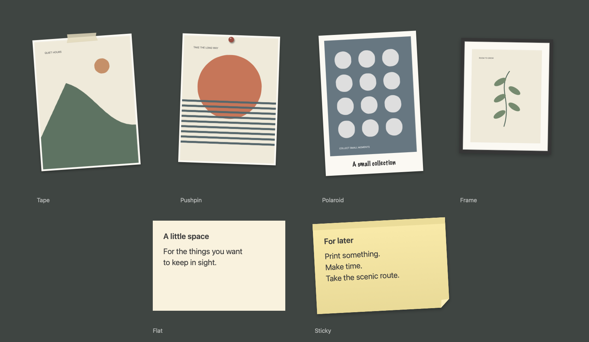

<p align="center">
  
</p>
<h1 align="center">Cork</h1>
<p align="center">A wall for your Mac.</p>
<p align="center">
  
  
  
  <a href="https://github.com/upsidedly/cork/releases/latest"></a>
  <a href="LICENSE"></a>
</p>

Cork puts posters, photos, video prints and notes on your desktop. Tape up a print, pin a photo, or leave a sticky beside it. Roll a new collage when you want a change. It shares a monochrome style with [Tuck](https://github.com/Upsidedly/tuck), [Snap](https://github.com/Upsidedly/snap) and [Cell](https://github.com/Upsidedly/cell).

**[Download Cork for macOS](https://github.com/upsidedly/cork/releases/latest)** · Apple silicon and Intel · macOS 14+

Drag Cork into Applications. The Pinterest importer is included. This community build is ad hoc signed and **not notarized**; follow [Apple's Open Anyway instructions](https://support.apple.com/guide/mac-help/open-a-mac-app-from-an-unknown-developer-mh40616/mac) if macOS blocks the first launch.

<p align="center">
  
</p>

## Put something on the wall

Open Cork from the menu bar. Choose **Add Images or Videos…**, paste an image, or drop files into the library. Pick **Tape**, **Pushpin**, **Polaroid** or **Frame**. Cork keeps a local copy and preserves the image's proportions. Polaroid captions are optional and use marker lettering.

Videos use the same paper treatments. They stay still until you hover, then loop silently. Move away and the cover returns. Click a video and press **Space** for keyboard playback; **Escape** stops it. Reduce Motion turns off hover playback while keeping this explicit control. MP4, MOV and M4V files up to 200 MB and ten minutes are supported. Cork measures five frames before including a video in a colour-matched collage.

**Double-click a video** to zoom it into the wallpaper. **Double-click the wallpaper again**, or press **Escape**, to return the print and previous background. **Return** opens the same effect from a focused video. The preview stays behind app windows and keeps your saved layout intact; it reuses the existing clip. Reduce Motion removes the zoom.

Choose **New Note** for editable text on **Flat** paper or a shaded **Sticky**. Check **Include in layout** to reserve its space, or untick it to float the note over your pictures. **Match collage colours** tints the paper to suit the visible photos.

Choose **Edit Desktop** to drag, resize and rotate items. The library also has X/Y sliders and exact dimensions. An **eye** button hides an item and repacks the wall around it. **Keep in place** protects a print during future rolls. Finish with **Done** or **Esc**.

## Roll another wall

Click the **dice**, press **⌘R**, or use **⌃⌥⌘R** from any app. Cork picks from your saved photo collection, mixes source boards and print styles, and fits images into the free rectangles. Notes and kept prints stay put. **⌘Z** restores the previous scene, including its wallpaper.

Choose a mood in **Settings → Rotation**, or leave **Surprise me** selected. Colour matching uses twenty-two built-in palettes, including eight pairs such as **Blue & butter**, **Teal & rust** and **Cobalt & vermilion**. Paired palettes balance both colour families across the collage. Automatic wallpapers must fit your display at native resolution and match the selected photos. You can turn either kind of matching off.

**Fill Empty** adds pictures around the items you have placed. **Arrange → Fill Space** repacks the existing prints. Changing your display size refits the wall and can fill newly available space.

Want your own combination? **Choose two colours** is at the top of Cork's main window, beside the dice. The left slot is **Dominant**, guiding the wallpaper and larger colour share; the right is **Secondary**. Either can be **Random**: **Blue + Random** keeps blue dominant, **Random + Blue** keeps blue secondary, and **Random + Random** refreshes both. Fixed pairs such as **Red + Violet** work too. Choose **Strong colours** or **Include accents**. Cork measures colour coverage locally, saves each image's classification and analyses future imports automatically.

Import a collection through Settings or let an agent prepare one using the [collection format](docs/COLLECTIONS.md). Moods are curated image groups; Cork uses their saved colours, proportions and source metadata to compose each wall. A fresh installation starts with an empty photo and wallpaper library. Rolls work offline after import.

Click the **star** to name a favourite corkboard and load it later. It saves the layout, notes, widget state and wallpaper without copying your images. Loading a favourite is undoable and keeps your global shortcuts and schedule.

The **clock** sets automatic rolls: every minute, hour, day or week, morning and evening, or a custom interval. Scheduling starts **off**. Cork keeps notes and protected prints, waits while you edit, and catches up once after sleep. Cork must be running; enable Open at Login if you want it to start with your Mac.

## Bring your Pinterest

Choose **Import from Pinterest…** in Cork. The companion **cork-importer** connects to a browser profile you select, lists your boards, and offers **20**, **50**, **100**, **150**, **200** or **All** images from each. Review the gallery, remove what you do not want, then **Add to Cork**. Videos are skipped. Incomplete feeds are reported. Interrupted reviews resume without importing the same pin twice.

Before connecting, the importer asks for explicit consent to read **Pinterest cookies only**. Chrome-based browsers may show a macOS prompt for their Safe Storage key. Cookies remain in memory, are sent only to Pinterest, and clear on disconnect or quit. Supported profiles: Chrome, Chromium, Brave, Edge and Firefox. Safari is not supported yet. This uses Pinterest's website endpoints, so website changes can affect importing.

Image colours are measured locally. Pin links, source-board identity, aspect ratios, strong colours and accents travel into Cork. A collage mixes sources within the selected palette; three or more matching boards use about a 40% cap per board, and two use about 60%. Large libraries use a bounded, seeded candidate sample. Cork supports up to **20,000 library images**, subject to available disk space.

See [the importer guide](docs/IMPORTER.md) for privacy, storage and recovery details.

## Make the desktop yours

In Settings, hide desktop file icons, hide Apple widgets, choose an image or looping video wallpaper, and enable **Open Cork at login**. Hiding files changes their visibility while Cork runs; everything stays in your Desktop folder. Quitting reveals the original desktop again.

Cork also sets the native wallpaper so the macOS menu bar matches. Video wallpapers use their poster frame for the menu-bar colour. Your original system wallpaper and display options return when you choose **System** or quit Cork.

Prints, notes, wallpaper and settings restore when you reopen Cork. Saved note text uses **Save Note**; other layout changes save automatically.

Press **⌃⌥⌘M** to minimize application windows to the Dock. They stay minimized until you restore them. Change this shortcut in Settings, or enable the gesture: hold two fingers still and swipe down with a third. Minimizing other apps requires Accessibility permission.

## Add desktop toys

[Swingset](https://github.com/Upsidedly/swingset) supplies ten fidget toys. Choose one there and click **Add to Cork**. Cork keeps its own widget copy and saved state, so you can quit Swingset afterward.

Other apps can register local HTML, CSS and JavaScript widget packages through **Settings → Widgets**. See the [widget guide and working example](docs/WIDGETS.md).

## Let an agent arrange it

Cork includes a local MCP server. Copy its configuration from Settings, or add:

```json
{
  "mcpServers": {
    "cork": {
      "command": "/Applications/Cork.app/Contents/MacOS/cork-mcp"
    }
  }
}
```

The agent can add images and notes, import collections, arrange or roll the wall, manage favourites, schedules and widgets, and request desktop screenshots. An agent's Pinterest plugin can still find and download pins, then pass local files and metadata to Cork. The bundled importer works independently of an agent or plugin.

See the [user guide](docs/USAGE.md#let-an-agent-arrange-it) for tools, coordinates and screenshot modes.

## Install from source

Use macOS 14 or later with Swift 6 and a compatible macOS SDK.

```sh
git clone https://github.com/Upsidedly/cork.git
cd cork
./scripts/install.sh
open /Applications/Cork.app
```

Quit Cork before updating it. The installer builds and signs both apps locally, backs up an earlier installation and leaves your wall intact. After a rebuild, macOS may require you to remove and re-add Cork's permission entries.

## Compatibility and privacy

Accessibility is needed for minimizing other apps. Screen Recording is needed for requested desktop screenshots; captures are saved locally and returned to the requesting MCP client. Adding pictures, arranging the wall and rolling collections need neither permission.

The optional trackpad gesture uses a private macOS API and can be affected by system updates. The keyboard shortcut remains available independently of that API.

Cork needs no Cork account and has no hosted service or telemetry. Its optional importer contacts Pinterest and Pinterest's image CDN. Images, notes, collections, favourites and settings stay in `~/Library/Application Support/Cork`. Unfinished reviews stay in `~/Library/Application Support/Cork Importer`; browser credentials are never saved there. Personal Pinterest media is not included in this repository or download. Widget packages are restricted to their local files and cannot access the network.

## Development

Build with `./scripts/build.sh`. Run the core checks with `./scripts/check.sh` and importer checks with `./scripts/check-importer.sh`. Set `CORK_SDK` to use another compatible SDK without changing global Xcode settings. `CORK_UNIVERSAL=1 ./scripts/build.sh` and `./scripts/package-dmg.sh --no-build` produce a universal DMG. Version tags run the GitHub release workflow.

See the [user guide](docs/USAGE.md), [development notes](docs/DEVELOPMENT.md), [source references](docs/RESEARCH.md) and [verification record](docs/VERIFICATION.md).

## License

Copyright © 2026 Upsidedly. Cork is free software under the **GNU Affero General Public License, version 3 or later**. See [LICENSE](LICENSE) and [COPYRIGHT](COPYRIGHT).
